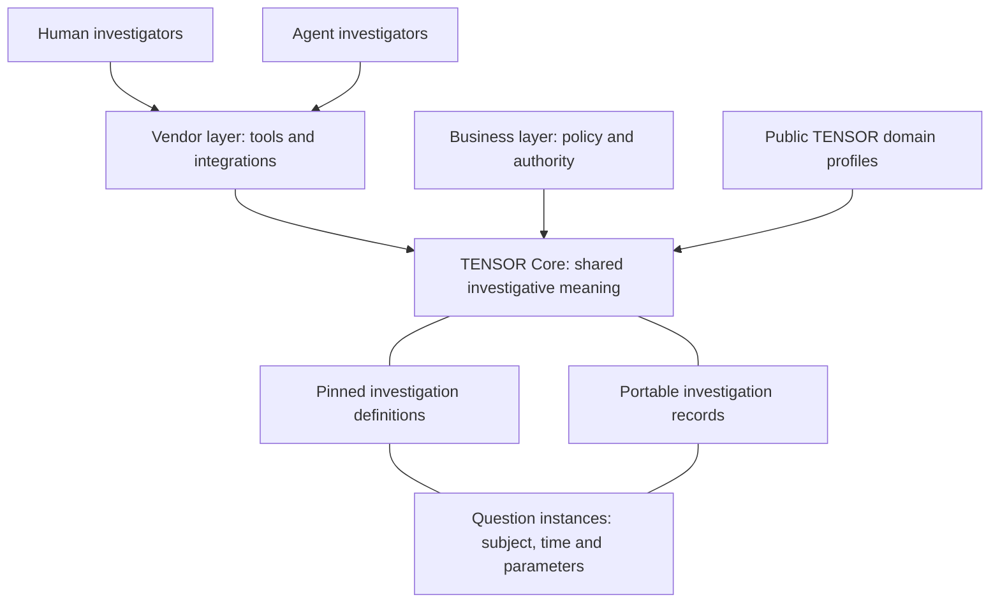

# TENSOR founding proposal and Core contract

Proposal `0.1.0` · October 10, 2026 · Proposed for public review

TENSOR is being developed as a public-good standard for all cyber investigations, usable by humans and agents through one shared investigative layer. Vendor and business layers compose above that layer.

This directory preserves the founding proposal. It is not a ratified standard, an institutional endorsement, or a claim that existing graph tooling conforms. Proposal `0.1.0` does not replace existing graph/schema versions. A separately identified **implementation candidate `0.1.0-draft.1`** now exercises this logical contract; its choices remain open to review.

## Read in this order

1. [Founding charter](00-charter.md): purpose, scope, public commitments, and boundaries.
2. [Core contract](01-core-contract.md): 38 proposed requirements, definitions, question instances, evidence, assessments, decisions, revisions, exchange, and scoped conformance.
3. [Governance proposal](02-governance.md): proposed roles, independent review, decisions, appeals, and stewardship.
4. [Standards crosswalk](03-standards-crosswalk.md): comparison with adjacent standards and explicit reuse questions.
5. [Reference cases and conformance scenarios](04-reference-cases-and-conformance.md): two synthetic cases and twelve proposed independent-exchange scenarios.
6. [Review plan](05-review-plan.md): evidence gates for implementation, independent exchange, and recognition.
7. [Change and decision register](06-change-and-decision-register.md): founding decisions, preservation boundaries, and unresolved stable-release choices.

The [architecture source](architecture.mmd), [original illustrative examples](examples/README.md), and [validation boundaries](VALIDATION.md) accompany the text. There is no Word or binary review-copy dependency in this repository package.

## Proposal and implementation status

The [candidate binding](https://github.com/TENSOR-Standards-Consortium/TENSOR-Framework/blob/codex/core-investigation-contract/core/v0.1.0-draft.1/binding.md) chooses an explicit trial representation. The [candidate implementation](https://github.com/TENSOR-Standards-Consortium/TENSOR-Framework/blob/codex/core-investigation-contract/core/v0.1.0-draft.1/README.md) supplies schemas, a validator, a CLI, and candidate bundles. Its [coverage](https://github.com/TENSOR-Standards-Consortium/TENSOR-Framework/blob/codex/core-investigation-contract/core/v0.1.0-draft.1/coverage.md) identifies mechanically checked requirements and areas needing other evidence. The [design decision](https://github.com/TENSOR-Standards-Consortium/TENSOR-Framework/blob/codex/core-investigation-contract/docs/adr-001-candidate-json-binding.md) explains why a trial binding exists while CASE/UCO reuse remains unresolved before a stable release.

The logical contract is retained without rewriting its 38 requirements to fit the prototype. Its references to a “future binding” describe the original proposal boundary; the separately versioned trial does not ratify that binding. Original illustrative JSON and candidate bundles have different identities and must not be interchanged silently.

The reference cases' C01–C12 matrix is an independent-exchange plan. Reference-implementation tests are useful evidence but do not constitute completed independent trials. Named stewards, adopted rights policies, external partners, and independent approvals remain unestablished by this package.

## Architecture

Public profiles and Core do not require a vendor subscription. Imported records do not grant access or authorize action. Existing versioned graphs and their release contracts remain intact.
